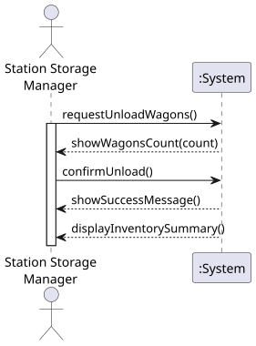
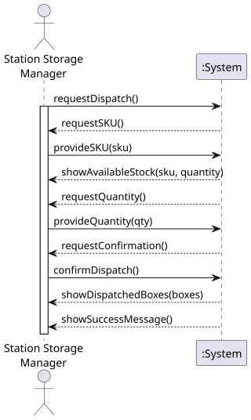

# USEI01 - Warehouse Management System (WMS) - FEFO/FIFO Unloading Operations

## 1. Requirements Engineering

### 1.1. User Story Description

As a terminal operator, I want unloading operations of wagons to
automatically store inventory using FEFO and/or FIFO logic, so that I can ensure
the correct dispatch order and minimize product spoilage

### 1.2. Customer Specifications and Clarifications 

**From the specifications document:**

> **Context** : When wagons arrive at the terminal and are unloaded into ware
houses, the sequence in which products are stored and dispatched is critical for
maintaining inventory accuracy, traceability, and operational efficiency.
Perishable goods must be handled strictly according to their expiry dates,
following the First-Expired-First-Out (FEFO) principle. This ensures that goods
closest to expiration are dispatched first, minimizing spoilage and waste.
Non-perishable goods, without expiry dates, should be managed under a
First-In-First-Out (FIFO) discipline. This guarantees a fair rotation of stocks and
prevents inventory stagnation. Each item with a unique SKU is stored in boxes,
each with a unique location code (Aisle/Bay) to facilitate picking and restocking.
Every movement of goods (whether unloading, relocation between bays, transfer
to another aisle or bay, or final dispatch) is meticulously recorded in a warehouse
management system (WMS). This ensures:
>1. Accurate stock tracking by SKU and storage location.
>2. Full traceability of all cargo throughout the cargo’s lifecycle in the terminal.

**From the client clarifications:**

> Regarding the products in the bays, a bay may contain boxes of different SKUs. The bay’s LinkedList is a single ordered list (by expiry↑, receivedAt↑, boxId↑) across all SKUs.
> You do not model physical obstruction within a bay. Think of bays as shelves with direct access to any box by ID. The FEFO order is a preference for which box should be consumed first, not a LIFO/queue constraint. You simply update or remove the target box’s node in the bay list; nothing else moves.
> The relocation must be requested.
> The waggon boxes of a train can be stored in more than one warehouse at the same railway station. Use existing warehouses with a fixed precedence (e.g., warehouseId ASC), filling them to capacity before moving on to the next warehouse.
> If all the warehouses are full, you must log the wagons that could not be unloaded.
### 1.3. Acceptance Criteria

* **AC1:** Stock initialization/unloading wagons- The file wagons.csv contains the avail
  able stock per SKU. Each wagon’s contents should be assigned to an aisle/bay,
  and their products must be inserted into the correct position inside the bay
  accordingly to the following rules:
  * (a) boxes are ordered by expiry date (earliest first; null last)
  * (b) receivedAt (oldest first)
  * (c) boxId ASC (tie-break)
* **AC2:** Dispatch operation- The operation dispatch must always consume stock from
  the “front” of the bay list, guaranteeing FEFO/FIFO behaviour. If a bay
  becomes empty, it remains in the WMS (the bay still exists), but the box list
  is empty; only delete empty boxes, not bays. Partial dispatch across multiple
  bays must be supported: if the target bay runs out, continue in the next bay,
  ascending number, that holds that SKU.
* **AC3:** Relocation- The operation relocation must update a box’s warehouseId/aisle/bay
  only; do not re-sort its new bay if its expiryDate/receivedAt is unchanged ex
  cept for inserting it into the new bay’s FEFO position.

### 1.4. Found out Dependencies

* No dependiencies were found out up to now.

### 1.5 Input and Output Data

**Input Data:**

* Typed data:
    * a reference
    * a designation 
    * an informal description
    * a technical description
    * an estimated duration
    * an estimated cost
	
* Selected data:
    * a task category 

**Output Data:**

* List of existing task categories
* (In)Success of the operation

### 1.6. System Sequence Diagram (SSD)

**_Other alternatives might exist._**

### 1.7 Other Relevant Remarks

* The created task stays in a "not published" state in order to distinguish from "published" tasks.