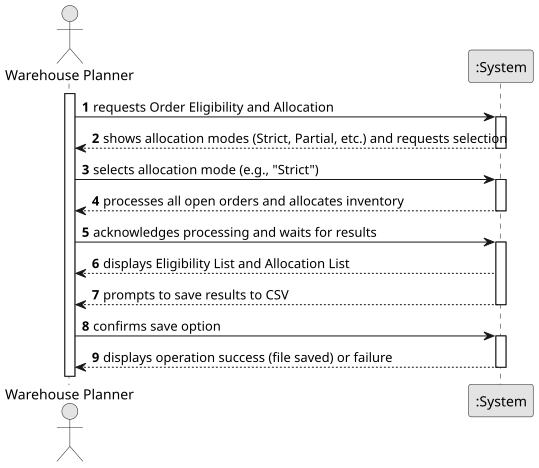

# USEI02 - Order Eligibility & Allocation

## 1. Requirements Engineering

### 1.1. User Story Description

As a warehouse planner, when I receive open orders, I want the system to examine current inventory and allocate quantities from boxes in FEFO order, and produce per-line statuses (ELIGIBLE, PARTIAL, UNDISPATCHABLE) and a list of allocation rows with box and bay information.

### 1.2. Customer Specifications and Clarifications

**From the specifications document (sem3_pi_2025_26_en_v1.1.pdf):**

> **Context**: A warehouse planner must fulfill the orders it receives. To achieve this, he needs to verify from the inventory which order lines can be dispatched and, for those, allocate concrete quantities from boxes using FEFO rules.
>
> **Processing Rules**: Orders are processed by: priority ASC, dueDate ASC, orderId ASC. Within an order, lines are processed by lineNo ASC (input order). For each line, allocation walks the SKU's boxes in FEFO/FIFO order.
>
> **Allocation Modes**: The system supports two modes: flag eligibility strict, partial, the default is strict:
>
> * **strict**: a line is ELIGIBLE only if its entire requested quantity is allocated; otherwise it is UNDISPATCHABLE (no allocations for that line are kept).
>
> * **partial**: if 0 < allocated < requested, mark the line PARTIAL and keep the allocated portion; if allocated = 0, mark UNDISPATCHABLE.
>
> **Returns**:
>
> * a list of orders eligibility with: orderId, lineNo, sku, requestedQty, allocatedQty, status;
>
> * output allocations (one row per allocation fragment): orderId, lineNo, sku, qty, boxId, aisle, bay.

**From the client clarifications (Based on implementation choices):**

> No clarifications were made up to now.

### 1.3. Acceptance Criteria

* **AC1:** The system must load all `orders.csv` and `order_lines.csv` files upon entering the feature.

* **AC2:** The system must process orders in the specified priority: `priority ASC`, then `dueDate ASC`, then `orderId ASC`.

* **AC3:** When "Strict Mode" (Option 1) is selected, the system must generate and display an Eligibility List and an Allocation List, following the `strict` rules.

* **AC4:** When "Partial Mode" (Option 2) is selected, the system must generate and display an Eligibility List and an Allocation List, following the `partial` rules.

* **AC5:** When "Compare Modes" (Option 3) is selected, the system must run both allocation modes and display a summary of statistics (e.g., total eligible, partial, undispatchable orders) for each.

* **AC6:** When "View Statistics" (Option 4) is selected, the system must display general statistics about the loaded orders (e.g., total orders, total lines, orders by priority).

* **AC7:** After running options 1, 2, or 3, the system must prompt the user to save the generated report(s) to a CSV file.

### 1.4. Found out Dependencies

* **USEI01 - Wagons Unloading:** This US is critically dependent on USEI01. The inventory (stock in bays) must be loaded and structured according to FEFO/FIFO rules *before* this US can perform any allocations.

* **Data Files:** This US depends on the existence and correct format of `orders.csv` and `order_lines.csv`.

* **USLP02 - UI:** This feature is accessed via the text-based UI defined in USLP02.

### 1.5. Input and Output Data

**Input Data:**

* **Pre-loaded data:**

  * Inventory data structures (SKUs, Bays, Boxes sorted by FEFO/FIFO) from USEI01.

  * Order data (`orders.csv`, `order_lines.csv`).

* **Selected data:**

  * User's menu choice ("Strict", "Partial", "Compare", "Stats").

  * User's confirmation to save results ("Y" or "N").

**Output Data:**

* **Eligibility List:** A list/table showing `orderId`, `lineNo`, `sku`, `requestedQty`, `allocatedQty`, `status`.

* **Allocation List:** A list/table showing `orderId`, `lineNo`, `sku`, `qty`, `boxId`, `aisle`, `bay`.

* **Statistics Report:** A summary of order counts, line counts, and priority counts.

* **Comparison Report:** A side-by-side statistical summary of running 'Strict' vs. 'Partial' modes.

* (In)Success of the operation (e.g., "File saved successfully", "No open orders found").

### 1.6. System Sequence Diagram (SSD)

### 1.7. Other Relevant Remarks

* The specified processing order (`priority`, `dueDate`, `orderId`) is critical. Since stock is consumed as orders are processed, changing this order would produce different allocation results.

* The "Allocation List" generated by this US (modes 1 and 2) serves as the primary input for **USEI03 - Picking Plans**.