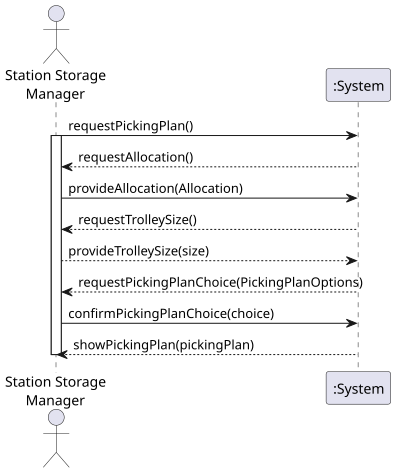

# USEI03 - Warehouse Management System (WMS) - Picking Plans

## 1. Requirements Engineering

### 1.1. User Story Description

As a planner, I want to pack the allocation rows produced by USEI02 into
capacity-bounded trolleys, choosing one of the packing heuristics, so pickers
can complete runs without overloading trolleys.

### 1.2. Customer Specifications and Clarifications

**From the specifications document:**

> **Context**: To satisfy the list of orders elaborated in the previous USEI02, it is
required to collect products from one or more points in the warehouse – a process
named "picking". Pickers often use a trolley (or cart) to collect items, but all trolleys
have a weight (kg) capacity that must be respected. Therefore, it is necessary to have
a pick plan that dispatches orders, or parts of orders, that fit within the capacity of
the trolley. So, pickers can safely transport without exceeding the trolley's capacity.
>
> In the warehouse, the following packing heuristics are used:
> - **First Fit (FF)**: Place the item in the first available trolley, where it fits. The
    scan order should be the input order of the allocation rows.
> - **First Fit Decreasing (FFD)**: Sort unpacked allocations from US02 by weight
    from largest to smallest and place the item in the first available batch where it fits.
> - **Best Fit Decreasing (BFD)**: Sort all unpacked allocations from US02 by weight,
    from largest to smallest, and put the item into the batch that will result in the
    smallest amount of remaining unused capacity, i.e., the tightest fit.
>
> If a single order line does not fit in the remaining capacity, either:
> - Split it: put part in the current wave, log a "partial allocation," and carry the
    remainder to the next trolley; or
> - Defer it entirely: log "skipped due to capacity," and put the full line in the
    next trolley.

**From the client clarifications:**

> There is no limit on the number of trolleys; their capacity should be defined by the planner.
> The planner must dispatch the orders, executing any one of the three packing heuristics
on the same set of order lines.

### 1.3. Acceptance Criteria

* **AC1:** The planner defines the trolley capacity (in kg) that will be used for all trolleys
  in the picking operation.
* **AC2:** The system must support three packing heuristics:
  * (a) **First Fit (FF)** - process allocations in input order, placing each in the first
    trolley where it fits
  * (b) **First Fit Decreasing (FFD)** - sort allocations by weight DESC, then apply
    First Fit logic
  * (c) **Best Fit Decreasing (BFD)** - sort allocations by weight DESC, then place
    each in the trolley with smallest remaining capacity where it fits
* **AC3:** For each heuristic execution, the system must display:
  * The total number of trolleys necessary to dispatch the orders
  * Utilisation of each trolley (usedWeight/capacityWeight, e.g., 85% full)
  * For each trolley, provide the picking plan with all: order ID, line number, aisle,
    bay number, boxId, SKU, quantity
* **AC4:** If a single allocation does not fit in the remaining capacity of any existing
  trolley, the system must create a new trolley for it.
* **AC5:** The system must calculate the weight of each allocation based on the SKU's
  unitWeight (from items.csv) multiplied by the allocated quantity.

### 1.4. Found out Dependencies

* **USEI02** - Order Eligibility & Allocation must be completed first, as this US uses
  the allocation rows produced by USEI02 as input.
* **items.csv** - Must contain valid unitWeight values for each SKU to calculate
  allocation weights.

### 1.5. Input and Output Data

**Input Data:**

* Typed data:
  * trolley capacity (in kg)
  * selected heuristic (FF, FFD, or BFD)

* Selected data:
  * allocation rows from USEI02 (orderId, lineNo, sku, qty, boxId, aisle, bay)
  * item weights from items.csv (SKU, unitWeight)

**Output Data:**

* For each heuristic:
  * Total number of trolleys used
  * For each trolley:
    * Trolley ID/number
    * Utilisation percentage (usedWeight/capacityWeight)
    * Picking plan details:
      * Order ID
      * Line number
      * Aisle
      * Bay number
      * Box ID
      * SKU
      * Quantity
      * Weight contribution
* (In)Success of the operation

### 1.6. System Sequence Diagram (SSD)

**_Other alternatives might exist._**

### 1.7. Other Relevant Remarks

* The trolley capacity is a hard constraint and must never be exceeded.
* Different heuristics may produce different numbers of trolleys for the same set of allocations.
* The Best Fit Decreasing heuristic typically produces better packing efficiency (fewer trolleys)
  compared to First Fit, but requires more computational effort.
* Weight calculations must handle decimal values appropriately (e.g., 0.5 kg per unit).
* The system should handle edge cases such as:
  * Single allocation heavier than trolley capacity (should be flagged as impossible to pack)
  * Empty allocation lists
  * Zero or negative trolley capacity values