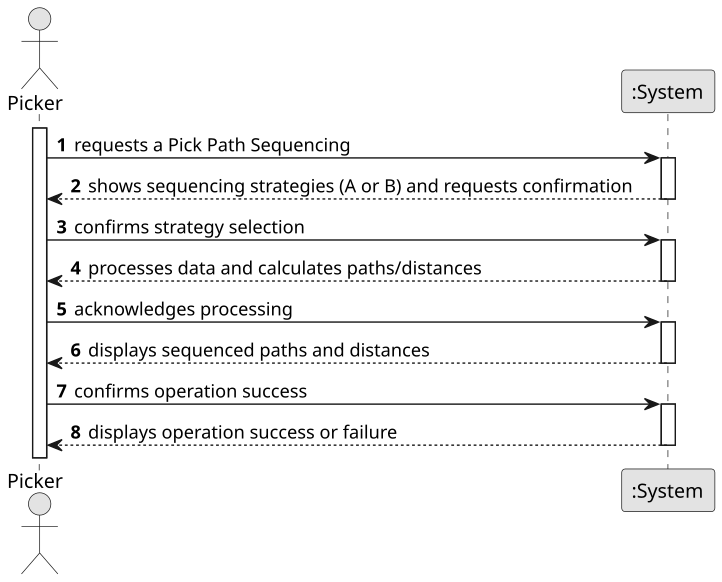

# USEI04 - Pick Path Sequencing

## 1. Requirements Engineering

### 1.1. User Story Description

As a picker, I want to plan the task of picking up several boxes, sequenced using a 2D layout (aisles & bays), so I minimize walking distance starting from the entrance at the main corridor, with no return leg.

### 1.2. Customer Specifications and Clarifications

**From the specifications document:**

> **Context**: The warehouses are organized in several aisles that are open spaces between rows of bays, that provide pathways to move goods and access bays — areas for storing products. A bay location is a coordinate pair (aisle * 3, bay). The entrance is at coordinate (0,0) on the main corridor.  
> Geometry & Distance Rules: Horizontal spacing between adjacent aisles = 3 units. The definition of the distance function D to go from coordinate (a1, b1) to coordinate (a2, b2) is given by the following movement model:
> - Same aisle (a1 == a2) : D = |b1 − b2|
> - Different aisles (a1 ≠ a2): must go down from b1 to the main corridor, move horizontally and then go up to b2: D = b1 + |a1 − a2| * 3 + b2  
    > Sequencing Strategies
> - Strategy A — Deterministic sweep.
    >   - Start by sorting the bays of boxes ascending by aisle.
>   - Next, calculate the distance to pick the boxes in that order (using the distance function D).
> - Strategy B — Nearest-neighbour (greedy) using the 2D distance above.
    >   - Start by sorting the bays using the distance function D.
>   - Next, calculate the distance to pick the boxes in that order (using the distance function D).  
      > Route Distance Formula  
      > Let the sequence of the coordinates of the n bays to pick be c1, c2, . . . , cn (each ci = (ai,bi), ai being an aisle and bi being a bay), and start c0 = (0,0). The total distance is calculated based on the distance function D as follows:  
      > DTotal = ∑ D(Ci, Ci+1)

**From the client clarifications:**

> No clarifications were made up to now.

### 1.3. Acceptance Criteria

- **AC1:** The input is the set of bays from the picking plan generated in the previous USEI03. Duplicate bays must be merged into a single stop (sum quantities) before sequencing, otherwise the same bay could appear multiple times in the path. For a picking plan (set of bays) both strategies must be executed and for each strategy return the path followed and the total distance.

### 1.4. Found out Dependencies

- There is a dependency to "USEI03 - Picking Plans" since the input for this user story is the set of bays from the picking plan generated in USEI03.

### 1.5 Input and Output Data

**Input Data:**

- **Typed data:**
  - Set of bays to pick (list of unique aisle/bay coordinates, with merged quantities for duplicates)

- **Selected data:**
  - (Implicit) Selection of sequencing strategies (both A and B are always executed)

**Output Data:**

- For each strategy (A and B): sequenced path (list of coordinates in order), total distance
- (In)Success of the operation

### 1.6. System Sequence Diagram (SSD)

**_Other alternatives might exist._**

### 1.7 Other Relevant Remarks

- The sequencing uses heuristic strategies (deterministic sweep and nearest-neighbour) to approximate minimal walking distance, but does not guarantee the absolute shortest path (e.g., no full TSP optimization). No return to entrance is required after the last bay.