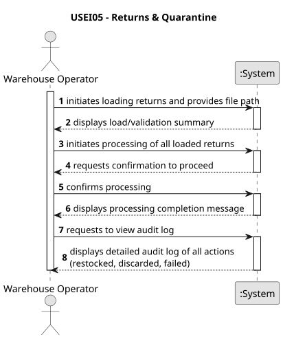

# USEI05 – Returns and Quarantine Management

## 1. Requirements Engineering

### 1.1. User Story Description

As a warehouse operator, I want to process returned goods by inspecting their condition and reason for return, so that I can restock valid items or discard damaged or expired ones, while maintaining traceability through an audit log.

### 1.2. Customer Specifications and Clarifications

**From the specifications document:**

> **Context:**  
> Returned goods arrive at the warehouse with information regarding the SKU, quantity, return reason, timestamp, and (optionally) an expiry date.  
> These goods must be inspected in a **quarantine process** before deciding their final fate:
> - Returns with **reason = “damaged”** or **“expired”** → must be **discarded**.
> - Returns with **reason = “customer-remorse”** or **“cycle-count”** → may be **restocked**.
>
> **Processing Rules:**
> - Returns must be processed in **reverse chronological order** (newest first).
> - Valid returns are transformed into new **Box** instances with:
    >   - `boxId = "RET-" + returnId`
>   - `receivedAt = now()`
>   - `expiryDate` = given expiry date or `null` if not available
> - Boxes are stored in the first available (non-full) bay of the warehouse.
>
> **Logging and Traceability:**
> - Each processed return must be recorded in an **Audit Log**, noting:
    >   - Return ID, SKU, quantity, and resulting action (`Restocked`, `Discarded`, or `FailedRestock`).
> - All logs are timestamped and appended to `Logs/audit_log.txt`.

**From the client clarifications:**

> **Q:** Should the audit log keep a complete historical record of all inspections (i.e., new entries are appended to the same file over time), or should it be reset/overwritten each time the application runs?
>
> **A:** Default to append-only (keep history).
> 
> **Q:** Under what circumstances can a returned product be partially restocked? ("if partially restocked, include qtyRestocked and qtyDiscarded")
> 
> **A:** Partial restock is for reasons where unit-by-unit acceptance makes sense; expired/damaged default to full discard; always log qtyRestocked and qtyDiscarded and insert the accepted portion as a new FEFO-sorted return box.

---

### 1.3. Acceptance Criteria

- **AC1:** The system must read return data from `returns.csv` and validate all fields.
- **AC2:** Returns must be processed in **reverse chronological order** (most recent first).
- **AC3:** Returns marked as *damaged* or *expired* must be **discarded** (not restocked).
- **AC4:** Returns marked as *customer-remorse* or *cycle-count* must be **restocked** as new boxes.
- **AC5:** Each restocked box must receive a unique ID in the form `"RET-" + returnId`.
- **AC6:** The result of every inspection (discard/restock) must be logged in `audit_log.txt`.

---

### 1.4. Found out Dependencies

- Depends on **USEI01 – Warehouse Loading**, since the warehouse, aisles, and bays must exist before restocking can occur.
- Depends on the **Item Catalog** imported earlier to validate that all SKUs in `returns.csv` are known.

---

### 1.5. Input and Output Data

**Input Data:**

- **Typed data:**
    - CSV file: `returns.csv`, containing the following columns:  
      `returnId, sku, qty, reason, timestamp, expiryDate(optional)`
    - Warehouse structure (Aisles, Bays, Items)
    - Item catalog (`Map<String, Item>`)

- **Generated data:**
    - List of validated `ReturnItem` objects (sorted newest first)

**Output Data:**

- Updated `Warehouse` inventory with new boxes (for restocked returns)
- Log file `Logs/audit_log.txt` containing:  
  `timestamp | returnId | sku | action | qty`
- Console summary showing the result of the operation (success, errors, inventory snapshot)

### 1.6. System Sequence Diagram (SSD)

**_Other alternatives might exist._**

### 1.7 Other Relevant Remarks

- Neither the SEMP3PI guide nor the Client Clarifications, "Partial restock is for reasons where unit-by-unit acceptance makes sense", clarify the criteria for a partial restock. 