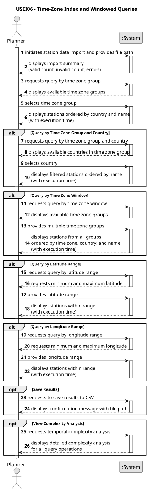

# USEI06 – Time-Zone Index and Windowed Queries

## 1. Requirements Engineering

### 1.1. User Story Description

As a planner, I want a set of BST/AVL trees that lets me quickly search stations by latitude, longitude, time zone group and country, so I can efficiently retrieve all stations of a time zone group by ascending order of country or in a window of time zone groups, such as ['CET', 'WET/GMT'].

### 1.2. Customer Specifications and Clarifications

**From the specifications document:**

> **Context:**  
> Planners need fast, reproducible lookups of stations by time zone group, and convenient searches by station name and country without scanning the 64k-row CSV.
>
> **User Story:**  
> As a planner, I want a set of BST/AVL trees that lets me quickly search by:
> - latitude
> - longitude
> - time zone group and country
>
> So I can efficiently retrieve all stations of a time zone group by ascending order of country or in a window of time zone groups, such as ['CET', 'WET/GMT'].
>
> **Validation Rules:**
> - Validate: non-empty name station, country, and time zone group
> - latitude ∈ [-90,90]
> - longitude ∈ [-180,180]
> - Reject invalid rows
> - If multiple stations share the same coordinates (e.g., Lisbon Santa Apolónia and Lisbon Oriente), the tree must preserve all these stations **sorted by name in ascending order**.
>
> **Returns:**
> - 3–5 sample queries
> - Temporal analysis complexity

**From the client clarifications:**

> **Q:** Should the station name comparison be case-sensitive for sorting purposes?
>
> **A:** Use natural ordering with locale-aware comparison (Portuguese collation). Station names should be sorted lexicographically, case-insensitive, with accents normalized.

> **Q:** When querying by time zone window, should the results be ordered?
>
> **A:** Yes. Results must be deterministic and ordered by: time zone group (alphabetically), then country (alphabetically), then station name (alphabetically).

> **Q:** Should the system support partial matches for time zone group names?
>
> **A:** No. Only exact matches are required. The system should be case-sensitive for time zone group queries.

> **Q:** What should happen if a query returns no results?
>
> **A:** Return an empty list and display a user-friendly message indicating no stations were found.

> **Q:** Should the execution time be measured for all queries?
>
> **A:** Yes. All queries should report execution time in milliseconds to demonstrate the efficiency of the tree-based indices.

---

### 1.3. Acceptance Criteria

- **AC1:** The system must validate all station records during CSV import (non-empty name/country/timeZoneGroup, valid lat/lon ranges).
- **AC2:** Invalid records must be rejected with clear error messages, while valid records are loaded.
- **AC3:** Three TreeMap indices must be built: latitude, longitude, and timeZoneGroup+Country composite.
- **AC4:** Stations at the same coordinates must be stored together and sorted by name (ascending).
- **AC5:** Query by time zone group must return stations ordered by country (ascending), then name (ascending).
- **AC6:** Query by time zone window must accept multiple groups and return deterministic results.
- **AC7:** Range queries (latitude/longitude) must efficiently use TreeMap.subMap().
- **AC8:** All queries must report execution time in milliseconds.
- **AC9:** The system must provide index statistics (total stations, unique coordinates, time zone groups).
- **AC10:** Results can optionally be exported to CSV format.

---

### 1.4. Found out Dependencies

- Depends on **CSV validation logic** to ensure data integrity before indexing.
- Depends on **Java TreeMap** implementation for BST/AVL-like performance guarantees.
- Depends on **Station model** with proper Comparable implementation for deterministic sorting.
- Integration point for **USEI07 – 2D-Tree Construction**, which will use the latitude/longitude indices.

---

### 1.5. Input and Output Data

**Input Data:**

- **Typed data:**
    - CSV file: `train_stations_europe.csv`, containing the following columns:  
      `country, time_zone, time_zone_group, station, latitude, longitude, is_city, is_main_station, is_airport`
    - Query parameters:
        - Time zone group (String)
        - Country code (String)
        - Multiple time zone groups (String[])
        - Latitude range (double minLat, double maxLat)
        - Longitude range (double minLon, double maxLon)

- **Generated data:**
    - Three TreeMap indices (latitude, longitude, timeZoneGroup+Country)
    - List of validated `Station` objects
    - Import statistics (valid/invalid counts, error messages)

**Output Data:**

- Import summary:
    - Total lines processed
    - Valid stations loaded
    - Invalid records rejected (with error details)
    - Index statistics

- Query results:
    - List of `Station` objects matching criteria
    - Execution time (milliseconds)
    - Result count
    - Optional: CSV export of results

- Complexity analysis:
    - Time complexity for index construction: O(N log N)
    - Time complexity for queries: O(log K + R) where K=index size, R=results
    - Space complexity: O(N)

---

### 1.6. System Sequence Diagram (SSD)



**_Other alternatives might exist._**

---

### 1.7 Other Relevant Remarks

- The system uses Java's `TreeMap`, which implements a Red-Black Tree (self-balancing BST) providing O(log N) performance for insertions and lookups.
- **Deterministic ordering** is critical: stations at identical coordinates must always appear in the same sequence (sorted by name) across queries.
- **Locale-aware sorting** uses Portuguese collation (`Collator.getInstance(new Locale("pt", "PT"))`) with PRIMARY strength to ignore accents during comparison.
- The time zone group index uses a **nested TreeMap structure**: `TreeMap<TimeZoneGroup, TreeMap<Country, List<Station>>>` to enable efficient queries by both dimensions.
- **Performance measurement** (execution time in milliseconds) demonstrates the efficiency gains of indexed queries versus linear scanning of 64k records.
- The implementation supports **fluent querying**: results from one query can be filtered further or combined with other queries.
- **Error handling** ensures that invalid latitude/longitude values are caught with descriptive messages before TreeMap operations.

---

### 1.8. Complexity Analysis

**Index Construction:**
```
- Adding N stations to TreeMap: O(N log N)
- Sorting lists at finalization: O(M log M) where M = max stations per coordinate
- Overall: O(N log N)
```

**Query Operations:**

| Operation | Complexity | Notes |
|-----------|-----------|-------|
| Query by Time Zone Group | O(log K + R) | K = # time zone groups, R = results |
| Query by TZ Window | O(W × (log K + R)) | W = # groups in window |
| Range Query (Lat/Lon) | O(log N + R) | Uses TreeMap.subMap() |
| Get All TZ Groups | O(K) | Direct keySet() access |
| Get Countries in TZ | O(C) | C = # countries in group |

**Space Complexity:**
```
- Three TreeMap indices: O(N)
- Additional lists for duplicates: O(N)
- Overall: O(N)
```

---

### 1.9. Sample Queries

**Query 1: Stations in CET time zone**
```
Input: timeZoneGroup = "CET"
Expected: All stations in Central European Time, grouped by country
Result count: ~15,000 stations (estimated)
```

**Query 2: Portuguese stations in WET**
```
Input: timeZoneGroup = "WET", country = "PT"
Expected: All Portuguese stations in Western European Time
Result count: ~200 stations (estimated)
```

**Query 3: Time zone window [CET, WET, EET]**
```
Input: timeZoneGroups = ["CET", "WET", "EET"]
Expected: Combined results from three time zones, deterministic order
Result count: ~25,000 stations (estimated)
```

**Query 4: Iberian Peninsula (latitude range)**
```
Input: minLat = 36.0, maxLat = 43.8
Expected: Stations in Spain and Portugal latitude range
Result count: ~1,500 stations (estimated)
```

**Query 5: Stations west of Prime Meridian**
```
Input: minLon = -180.0, maxLon = 0.0
Expected: All stations in Western Hemisphere
Result count: ~2,000 stations (estimated)
```