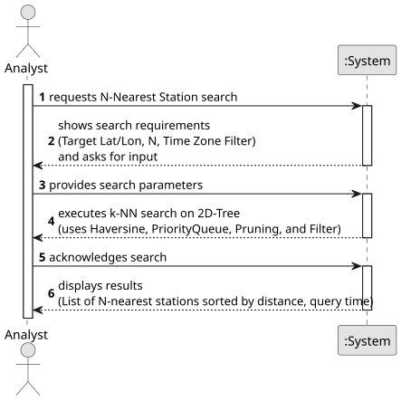

# USEI09 - Proximity Search (Nearest-N with Filters)

## 1. Requirements Engineering

### 1.1. User Story Description

"As an analyst, I want to find the nearest N stations to a given (lat, lon) using the 2D-tree, with optional filters, so I can get accurate nearby results efficiently."

### 1.2. Customer Specifications and Clarifications

**From the specifications document:**

> **Context**: Users need the N closest stations to a target coordinate (e.g., for nearest major hubs). 2D-tree should minimize explored nodes.
>
> **Distance Calculation**:
> - Must use **Haversine distance (km)** with Earth radius between two (lat, lon) points. This method is already implemented in `KDTree2D.java`.
>
> **Filtering**:
> - The search must enable optional filtering based on the **time zone criteria**.

**From the client clarifications (Forum):**

> **Clarification 1 (Filters)**: The only filter required for this functionality is based on time zone criteria.
>
> **Clarification 2 (Duplicate Coordinates / N < X problem)**: When searching for `N` closest stations, if the closest *coordinate* contains `X` stations (where N < X), **all X stations must be returned**. The system should treat all stations at the same (lat, lon) as a single unit (a node) for the purpose of finding the 'N' closest *locations*.

### 1.3. Acceptance Criteria

- **AC1:** The search must use the **Haversine distance** (km) to calculate and rank proximity.
- **AC2:** The search must accept an integer `N` representing the number of nearest *locations* (coordinate nodes) to find.
- **AC3:** The search must allow **optional filtering** based on time zone criteria.
- **AC4:** The system must return a list of the `n` nearest neighbours. In accordance with Clarification 2, this list may contain *more* than `N` stations if multiple stations share one of the `N` nearest coordinates.
- **AC5:** A temporal analysis of the algorithm's complexity must be provided.

### 1.4. Found out Dependencies

- **USEI06 (Station Index)**: Necessary for the initial loading of the 64k station data. Its BSTs/AVLs are used by USEI07.
- **USEI07 (2D-Tree Build)**: This is the primary dependency. The 2D-Tree **must be built** (using the `KDTree2D.java` and `Station.java` files) before the proximity search (USEI09) can be executed.
- **`KDTree2D.java`**: The implementation will be added to this class, reusing the existing `haversineDistance()` method.

### 1.5 Input and Output Data

**Input Data:**

- **Target Latitude** (double): The latitude of the search point (e.g., 41.14961).
- **Target Longitude** (double): The longitude of the search point (e.g., -8.61099).
- **N** (int): The number of nearest locations/nodes to find (e.g., 5).
- **Time Zone Filter** (Object): The optional time zone filter (e.g., `TimeZoneFilter` for "CET").

**Output Data:**

- **List of Stations** (`List<Station>`): A list of `Station` objects, sorted by distance ascending to the search point.
- **Query Time**: The execution time of the search (for the UI).
- **Temporal Complexity Analysis**: The formal complexity analysis of the algorithm.

### 1.6. System Sequence Diagram (SSD)

### 1.7 Other Relevant Remarks

