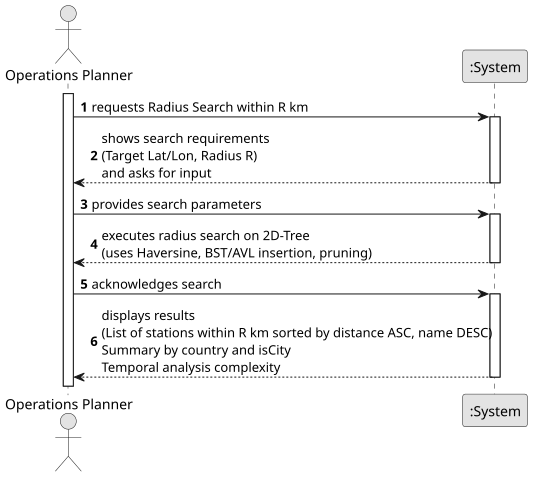

# USEI10 - Radius Search and Density Summary

## 1. Requirements Engineering

### 1.1. User Story Description

"As an operations planner, I want to fetch all stations within a radius R (km) of a target (lat, lon) using the 2D-tree, and get a summary by country and by isCity, so I can assess local coverage."

### 1.2. Customer Specifications and Clarifications

None until this moment.

### 1.3. Acceptance Criteria

- **AC1:** The search must use the **Haversine distance (km)** to calculate the distance between the target point and stations.
- **AC2:** The search must accept a **radius `R` in kilometers** as input.
- **AC3:** The system must return all stations **within the radius**, including their distance from the target.
- **AC4:** The result must provide a **density summary**: counts of stations by **country** and by **isCity** status.
- **AC5:** The stations must be returned in a **BST/AVL tree** sorted by distance (ascending) and station name (descending).
- **AC6:** A **temporal complexity analysis** of the algorithm must be provided.

### 1.4. Found out Dependencies

- **USEI06 (Station Index)**: Required to load the station data into memory.
- **USEI07 (2D-Tree Build)**: Must be built before USEI10 can execute radius searches.
- **`RadiusSearchResult.java`**: Stores the search result, including the sorted station tree and density summary.

### 1.5 Input and Output Data

**Input Data:**

- **Target Latitude** (double): The latitude of the search point.
- **Target Longitude** (double): The longitude of the search point.
- **Radius `R`** (double): The search radius in kilometers.

**Output Data:**

- **BST/AVL Tree of Stations** (`TreeMap<StationKey, Station>`): Sorted by distance ascending and station name descending.
- **Density Summary** (`DensitySummary`): Counts of stations grouped by country and by isCity status.
- **Query Time**: Execution time for the search (for performance tracking).
- **Temporal Complexity Analysis**: Formal analysis of the algorithm.

### 1.6. System Sequence Diagram (SSD)

### 1.7 Other Relevant Remarks

- The system should handle cases where no stations are found within the radius gracefully.
- The search should be efficient even for large radius queries covering thousands of stations.  
