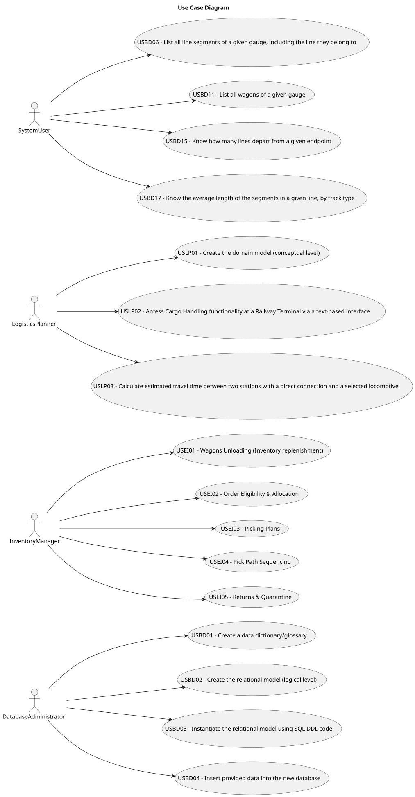

# Use Case Diagram (UCD)

**In the scope of this project, there is a direct relationship of _1 to 1_ between Use Cases (UC) and User Stories (US).**

However, be aware, this is a pedagogical simplification. On further projects and course units, there may also exist _1 to N **and/or** N to 1_ relationships between UC and US.

**Insert below the Use Case Diagram in a SVG format**

**For each UC/US, it must be provided evidence of applying main activities of the software development process (requirements, analysis, design, tests, and code). Gather those evidence on a separate file for each UC/US and set up a link as suggested below.**

# Use Cases / User Stories

| UC/US   | Description                                                                                                                              |
|:--------|:-----------------------------------------------------------------------------------------------------------------------------------------|
| USBD01  | [Create a data dictionary/glossary](glossary.md)                                                                                         |
| USBD02  | [Create the relational model (logical level)](../../bddad-us/USBD02/Modelo_er.png)                                                       |
| USBD03  | [Instantiate the relational model using SQL DDL code](../../bddad-us/USBD03/sem3pi092.ddl)                                               |
| USBD04  | [Insert provided data into the new database](../../bddad-us/USBD04/usbd04-script.sql)                                                    |
| USBD06  | [List all line segments of a given gauge, including the line they belong to](../../USBD06/USBD06-README.md)                              |
| USBD11  | [List all wagons of a given gauge](../../USBD11/USBD11-README.md)                                                                        |
| USBD15  | [Know how many lines depart from a given endpoint](../../USBD15/USBD15-README.md)                                                        |
| USBD17  | [Know the average length of the segments in a given line, by track type](../../USBD17/USBD17-README.md)                                  |
| USEI01  | [Wagons Unloading (Inventory replenishment)](../../USEI01/USEI01-README.md)                                                              |
| USEI02  | [Order Eligibility & Allocation](../../USEI02/USEI02-README.md)                                                                          |
| USEI03  | [Picking Plans](../../USEI03/USEI03-README.md)                                                                                           |
| USEI04  | [Pick Path Sequencing](../../USEI04/USEI04-README.md)                                                                                    |
| USEI05  | [Returns & Quarantine](../../USEI05/USEI05-README.md)                                                                                    |
| USLP01  | [Create the domain model (conceptual level)](../../USLP01/USLP01-README.md)                                                              |
| USLP02  | [Access Cargo Handling functionality at a Railway Terminal via a text-based interface](../../USLP02/USLP02-README.md)                    |
| USLP03  | [Calculate estimated travel time between two stations with a direct connection and a selected locomotive](../../USLP03/USLP03-README.md) |