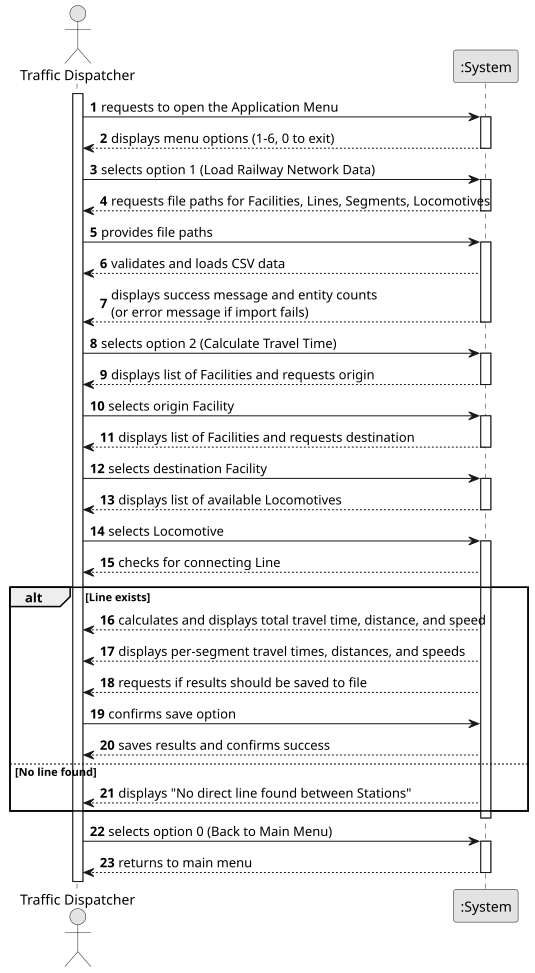

# USLP03 - Calculate Travel Time

## 1. Requirements Engineering

### 1.1. User Story Description

As a Traffic Dispatcher, I want to calculate the estimated travel time between two stations, with a direct connection between them, and a selected locomotive.

### 1.2. Customer Specifications and Clarifications

**From the specifications document (sem3_pi_2025_26_en_v1.1.pdf):**

> **(p. 5, 2.2.1 Railway Infrastructure):** "A line connecting two endpoints is composed of one or multiple line segments." ... "Important physical characteristics of line segments are the ... speed limit."
>
> **(p. 17, USLP03 Acceptance Criteria):** "In this version, acceleration can be assumed to be instantaneous. When presenting the results, the sections \[segments] should be listed in the order in which they will be covered, and the speed should be considered in the calculation of the trip."
>
> **(p. 17, 3.4 Non-functional Requirements):** "A significant part of the integration will be carried out through files." (This aligns with the SSD's "Load ... Data" step, which precedes this calculation).

**From the client clarifications:**

> No clarifications were made up to now.

### 1.3. Acceptance Criteria

* **AC1:** The system must allow the user to select an origin station from a list of available facilities.
* **AC2:** The system must allow the user to select a destination station from a list of available facilities.
* **AC3:** The system must allow the user to select a locomotive from a list of available locomotives.
* **AC4:** The system must validate if a direct line exists between the selected origin and destination.
* **AC5:** If no direct line is found, the system must display an error message "No direct line found between Stations".
* **AC6:** If a direct line is found, the system must calculate the total travel time, total distance, and average speed for the trip.
* **AC7:** The system must display the results, including the total time/distance and a breakdown of time/distance/speed for each segment ("section") in the order they are traversed.
* **AC8:** The calculation of travel time must use the speed limit of each segment (as acceleration is instantaneous).
* **AC9:** The system must offer the user the option to save the calculated results to a file.

### 1.4. Found out Dependencies

* This User Story has a dependency on the data being loaded into the system (as shown in "Opção 1" of the SSD). This includes data for Facilities (Stations), Lines, Segments, and Locomotives.
* There is an implicit dependency on **USLP01 (Domain Model)** for the definition of these entities.
* There is a dependency on the data provided by the **BDDAD component (e.g., USBD04)**, which serves as the source for the files loaded by the application.

### 1.5. Input and Output Data

**Input Data:**

* **Pre-loaded data:**
    * List of Facilities (Stations)
    * List of Lines
    * List of Segments (including speed limits and distances)
    * List of Locomotives
* **Selected data:**
    * Origin Facility (selected from list)
    * Destination Facility (selected from list)
    * Locomotive (selected from list)
    * User confirmation to save results to a file.

**Output Data:**

* List of Facilities (for selection)
* List of Locomotives (for selection)
* If a direct line exists:
    * Total travel time
    * Total distance
    * Average speed
    * A list of segments, each showing:
        * Segment ID/Name
        * Segment travel time
        * Segment distance
        * Segment speed (speed limit)
* If no direct line exists:
    * Error message: "No direct line found between Stations"
* Confirmation message upon successfully saving results to a file.
* (In)Success of the operation.

### 1.6. System Sequence Diagram (SSD)

### 1.7 Other Relevant Remarks

* The calculation is simplified for this sprint, as specified in the Acceptance Criteria: **acceleration is instantaneous**. The travel time for a segment is `distance / speed_limit`.
* This feature is limited to finding travel times only where a **direct line** connects the two stations. It does not perform complex pathfinding across multiple lines or routes.